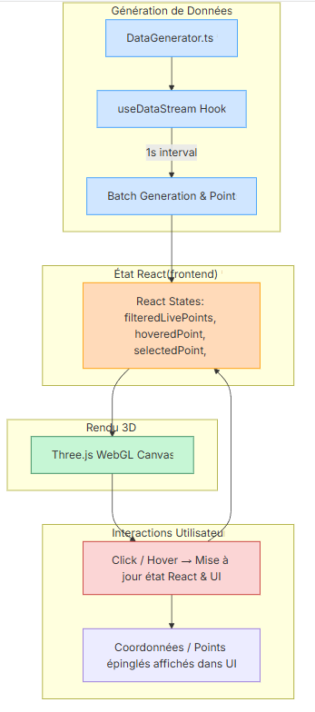
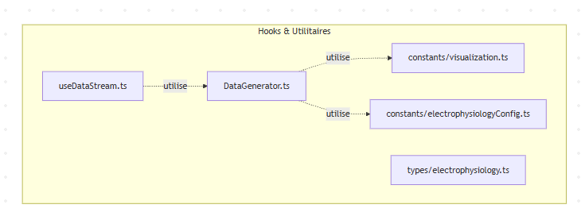
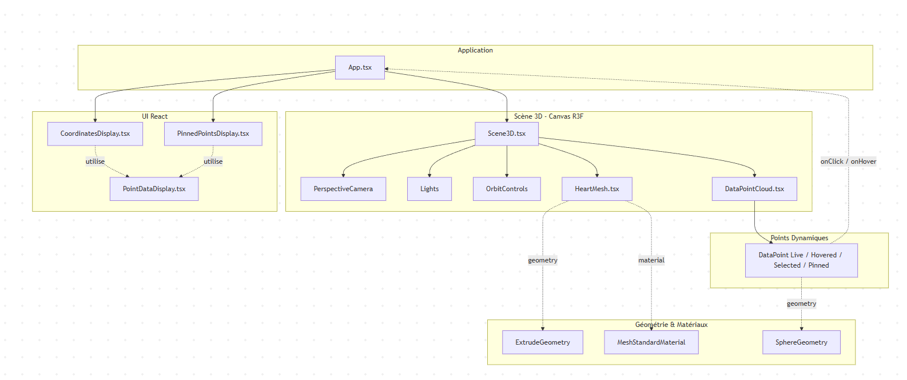

## Technologies

### Stack Principal
- React 19
- TypeScript 5.7.3
- Three.js 0.181.0
- React Three Fiber 9.4.0
- Vite 5.4.10

### Tests
- Vitest 4.0.7
- React Testing Library 16.3.0
- Happy-DOM 20.0.10
- 53 tests unitaires

## Architecture

```
src/
├── components/         Composants React/Three.js
├── hooks/             Custom hooks (useDataStream)
├── utils/             Générateurs de données
├── constants/         Constantes de configuration
├── types/             Définitions TypeScript
└── __tests__/         Suite de tests
```

### Composants Principaux

**Scene3D**
Configuration de la scène 3D avec caméra, éclairage et contrôles orbitaux.

**HeartMesh**
Modèle cardiaque 3D

**DataPointCloud**
Gestion du rendu des points électrophysiologiques. Utilise le hook useDataStream pour la génération de données. Affiche 100 points simultanément, qui bougent toutes les secondes.

**DataPoint**
Point de mesure 3D individuel avec coloration basée sur le voltage.

**PointDataDisplay**
Composant réutilisable pour affichage des données de point (type, voltage, coordonnées). Élimine la duplication de code entre CoordinatesDisplay et PinnedPointsDisplay.

**CoordinatesDisplay / PinnedPointsDisplay**
Interfaces utilisateur pour affichage et gestion des points sélectionnés et épinglés.

## Fonctionnalités

### Visualisation
- Modèle cardiaque 3D interactif avec manipulation caméra
- Stream temps réel de points électrophysiologiques
- Coloration basée sur voltage (cicatrice/zone frontière/tissu sain)

### Interactions
- Détection de mouse hover avec freeze automatique du point
- Sélection de points avec affichage des coordonnées
- Système d'épinglage pour comparaison multiple
- Indicateurs visuels uniques par couleur (10 couleurs distinctes)

### Classification des Tissus
- **Scar** (cicatrice) : voltage < 0.5 mV, couleur rouge
- **Border** (zone frontière) : voltage 0.5-1.5 mV, couleur orange
- **Healthy** (tissu sain) : voltage >= 1.5 mV, couleur violette

## Installation

### Prérequis
- Node.js 18+
- npm

### Étapes

```bash
cd front-end-candidat-achadr
npm install
npm run dev
```

Application disponible sur http://localhost:5173

## Scripts Disponibles

```bash
npm run dev          # Mode développement avec HMR
npm run build        # Build de production
npm test             # Exécution des tests

```

## Diagrammes d'Architecture

### Flux de Données Temps Réel



### Architecture des Composants





## Décisions Techniques

### React 19
Version stable récente avec fonctionnalités optimisées pour le rendu 3D.

Aussi le framework frontend où je suis le plus à l'aise

### Three.js + React Three Fiber
Approche déclarative avec gestion automatique de la mémoire et render loop.
S'intègre naturellement avec l'écosystème React basé sur les composants TSX, permettant de construire des scènes 3D avec la même logique que les interfaces UI React.

#### Approche Hybride : Trois Méthodes

**1. Three.js Pur (Impératif)**
Manipulation directe des objets 3D.
- Avantages : Contrôle total
- Inconvénients : gestion mémoire manuelle

**2. React Three Fiber (Déclaratif)**
Syntaxe JSX déclarative.
- Avantages : Gestion automatique de la mémoire, synchronisation Automatique avec React quand les props changent ou quand le composant est unmounted, intégration avec l'Écosystème React (hooks).
- Inconvénients : Difficile pour géométries complexes

**3. Hybride (HeartMesh.tsx)**
Three.js pour la géométrie complexe + React Three Fiber pour le rendu.

#### Exemple HeartMesh.tsx

**Partie 1 : Three.js (Géométrie)**
```typescript
const heartShape = useMemo(() => {
  const shape = new THREE.Shape()
  shape.moveTo(x + HEART_BEZIER_START[0], y + HEART_BEZIER_START[1])
  shape.bezierCurveTo(...) // x6
  return new THREE.ExtrudeGeometry(shape, extrudeSettings)
}, []) // Calculé 1 fois
```
Pourquoi ? Trop complexe pour JSX, optimisé avec useMemo

**Partie 2 : React Three Fiber (Rendu)**
```typescript
return (
  <mesh position={HEART_MESH_POSITION} rotation={[0, 0, HEART_MESH_ROTATION_Z]}>
    <primitive object={heartShape} attach="geometry" />
    <meshStandardMaterial color={HEART_MESH_COLOR} wireframe={true} />
  </mesh>
)
```
Pourquoi ? Simple, déclaratif, gestion automatique de mémoire

**Avantages Hybride** :
- Performance : Géométrie calculée 1 fois (useMemo)
- Lisibilité : Code Three.js séquentiel + JSX déclaratif
- Maintenance : Constantes centralisées

### TypeScript

**Décision :** Migration de JavaScript à TypeScript effectuée avant l'implémentation des interactions UI.

**But :**
- Anticiper les problèmes de typage des événements Three.js (ThreeEvent, PointerEvent)
- Sécuriser la gestion d'état multi-niveaux (hovered/selected/pinned)
- Auto-complétion et refactoring sécurisé

**Bénéfice :** Détection des erreurs de typage à la compilation plutôt qu'au runtime.

### Vite
Build tool moderne avec HMR instantané.
Modification du code → Mise à jour instantanée du module modifié uniquement

En développement : Le Hot Module Replacement instantané me permet d'ajuster les positions, couleurs et animations avec un feedback en quelques ms à l'écran. Pas besoin de rebuild complet à chaque modification

### Vitest + Happy-DOM
Framework de test natif Vite avec environnement DOM léger et rapide.

## Refactoring

### Phase 1 - Extraction des Constantes
Migration de 100+ valeurs codées en dur vers des fichiers de constantes centralisés :
- constants/visualization.ts - Configuration 3D, animations, UI
- constants/electrophysiologyConfig.ts - Paramètres médicaux et scientifiques

### Phase 2 - Organisation du Code
- Extraction du composant PointDataDisplay pour éliminer la duplication, vue que ce composant est utilisé au sein de 2 composants parents
- Création de la fonction classifyTissueType pour séparer la logique
- Ajout de 16 tests pour couvrir le nouveau code

### Phase 3 - Séparation des Responsabilités
- Extraction du hook useDataStream pour séparer la logique de génération du rendu
- DataPointCloud maintenant responsable uniquement du rendu 3D
- Hook réutilisable avec paramètres configurables (interval, batchSize)
- Génération par batch : N points générés et remplacés à chaque intervalle

### Résultats
- Élimination de la duplication de code
- Séparation claire des responsabilités (data/rendering)
- Amélioration de la testabilité et réutilisabilité


## Performance

- Memoization des composants (React.memo)
- Calculs mémoisés (useMemo)
- Géométrie partagée entre instances
- Animation 60fps via useFrame


## Problèmes Résolus

### Incompatibilité jsdom avec ES Modules
Migration vers happy-dom pour support natif des modules ES.

### Positionnement des Points
Ajustements itératifs du générateur pour alignement avec le modèle 3D du coeur.

### Sélection de Points en Mouvement
Implémentation du système freeze-on-hover pour faciliter la sélection.

## Structure de l'État (React State)

### Trois Niveaux de Points

**Hovered**
Point temporairement gelé au moment du hover de la souris (onHover state).

**Selected**
Point sélectionné persistant jusqu'à nouvelle sélection ou déselection manuelle.

**Pinned**
Points épinglés permanents avec indicateurs visuels uniques et panneaux UI dédiés.

## Système d'Indicateurs Visuels

Palette de 10 couleurs distinctes pour différencier les points épinglés :
- Anneaux  3D autour des points
- Bordures UI correspondantes sur les panneaux
- Cycle automatique pour plus de 10 points

## Build

```bash
npm run build
```

Génère un build dans `/dist`

## Tests

Suite de 53 tests couvrant :
- Génération de données (24 tests)
- Hook de streaming (11 tests)
- Composant DataPoint (10 tests  - tests de non-régression)
- Composant PointDataDisplay (8 tests)

### Rapport de Couverture

Couverture globale : 85.58% des statements

| Module | Statements | Branches | Functions | Lines |
|--------|-----------|----------|-----------|-------|
| utils/dataGenerator.ts | 100% | 100% | 100% | 100% |
| hooks/useDataStream.ts | 100% | 87.5% | 100% | 100% |
| components/PointDataDisplay.tsx | 100% | 100% | 100% | 100% |
| constants/ | 100% | 100% | 100% | 100% |
| components/DataPoint.tsx | 0% | 0% | 0% | 0% |

DataPoint.tsx non couvert car il s'agit d'un composant de rendu 3D WebGL. La logique métier qu'il utilise (getColorFromVoltage, classifyTissueType) est couverte à 100% dans dataGenerator.ts.

Toute la logique métier est testée :
- Génération de points électrophysiologiques
- Classification des types de tissus
- Mapping voltage vers couleur
- Contrôles du stream

## Configuration TypeScript

- Vérifications strictes des null/undefined
- Props typées pour tous les composants
- Interfaces pour structures de données


